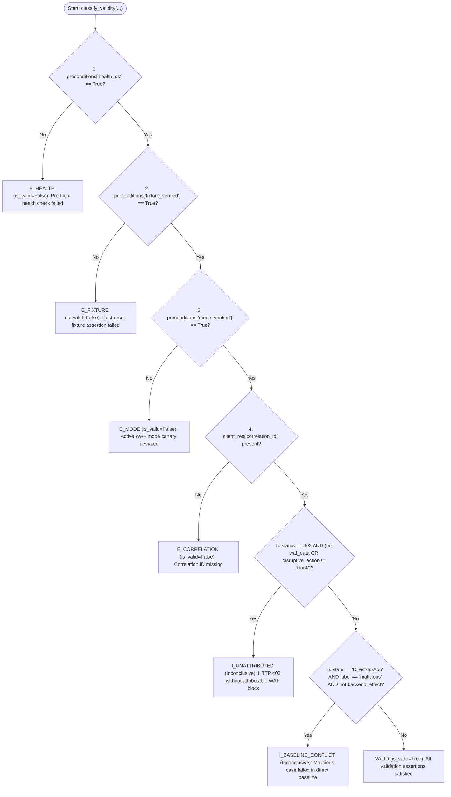

# Technical Explanation: Gateway ModSecurity Rules, Test Runner & Validity Oracle Decision Tree

---

## 1. ModSecurity Anomaly Scoring & SSRF Rule (`gateway/modsec/rules/custom.conf`)

### Why `setvar:tx.inbound_anomaly_score_threshold=+5` Was a Bug
In OWASP CRS v4.0.0 anomaly scoring mode, `gateway/modsec/crs.conf` (rule `900000`) initializes the blocking threshold:
* `tx.inbound_anomaly_score_threshold = 5`

Each matched inbound rule at Paranoia Level 1 (PL1) is supposed to increment the request's **score** (`tx.inbound_anomaly_score_pl1`), which CRS rule `949110` compares against `tx.inbound_anomaly_score_threshold`.
* **Old behavior:** Writing `tx.inbound_anomaly_score_threshold=+5` increased the *threshold* from `5` to `10` without adding any points to the request's score. As a result, SSRF probes could bypass anomaly-score detection in `DetectionOnly` mode.
* **Fixed behavior:** Writing `tx.inbound_anomaly_score_pl1=+5` adds `5` points directly to the request's PL1 inbound score (`0 + 5 = 5 >= 5`), matching the `crs.conf` threshold of `5`.

### How the Expanded SSRF Regex Works
Rule `200001` chains two conditions:
1. `REQUEST_URI "@streq /fetch"` — Scopes inspection strictly to the SSRF endpoint.
2. `ARGS:json.url "@rx ..."` (with `t:none,t:lowercase`) — Inspects the parsed JSON `url` field (enabled by rule `200000` in `main.conf`) for:
   * Loopback and unspecified addresses (`127.0.0.0/8`, `localhost`, `0.0.0.0`, `[::1]`, `[::ffff:127.0.0.1]`, hex `0x7f000001`, decimal `2130706433`).
   * Cloud metadata / link-local (`169.254.0.0/16`, `metadata.google.internal`).
   * Private RFC1918 ranges (`10.0.0.0/8`, `172.16.0.0/12`, `192.168.0.0/16`).
   * Internal mock target (`mock-internal` only when accessing `/metadata`), keeping benign `SSRF-001-B1` traffic (`/public/avatar.png`) allowed.

---

## 2. Audit Logging in `DetectionOnly` Mode (`gateway/modsec/main.conf`)

Previously, `main.conf` used:
```apache
SecAuditEngine RelevantOnly
SecAuditLogRelevantStatus "^(?:5|4(?!04))"
```
In `DetectionOnly` mode, ModSecurity evaluates rules and computes anomaly scores, but does **not** interrupt the request—so Nginx forwards the request and returns `200 OK`. Because `200` did not match `^(?:5|4(?!04))`, those rule triggers were omitted from `/var/log/modsec/audit.log`, leaving `telemetry-worker` blind during `DetectionOnly` runs.

Enabling `SecAuditEngine On` and updating `SecAuditLogRelevantStatus "^(?:5|4(?!04)|200)"` ensures every transaction (including `200 OK` detections in `DetectionOnly`) is written in Serial JSON format to `/var/log/modsec/audit.log`.

---

## 3. Automated 3-State Test Runner (`runner/test.py` & `runner/oracle/xss_lfi_ssrf_oracle.py`)

### A. Automatic WAF Mode Switching & Canary Verification
Before entering each evaluation phase in `STATES = ["Direct-to-App", "DetectionOnly", "Blocking"]`:
1. `switch_waf_mode(state)` updates `SecRuleEngine` inside `wb-gateway` (`/etc/modsecurity.d/main.conf`) and runs `nginx -s reload`.
2. `verify_waf_mode_canary(...)` sends a known XSS probe through `:8080` and verifies that the actual HTTP response matches the expected profile (`200` for `DetectionOnly`, `403` for `Blocking`).
3. `preconditions["mode_verified"]` is set from this real check rather than a hardcoded `True`.

### B. Controlled-Environment Rate Limiter
A sliding-window `RateLimiter` restricts request dispatch to `5 requests / 2.0 seconds` (configurable via environment variables) so Nginx, ModSecurity, and the target database experience uniform load across all three phases.

### C. Immediate `normalized_events` Persistence & WAF Telemetry Correlation
1. Immediately after `mgr.send_request(...)`, `insert_normalized_event(...)` writes the base client record (including `correlation_id`, `case_id`, `family_id`, `label`, `state`, `client_status`, `request_sha256`) into PostgreSQL `event-db`.
2. In `DetectionOnly` and `Blocking` phases, `fetch_waf_telemetry(...)` polls `normalized_events` by `correlation_id` until `telemetry-worker` populates `waf_txn_id` / `disruptive_action`.
3. Passing that real `waf_data` dictionary (instead of `None`) into `classify_validity(...)` prevents valid `403` blocks from being misclassified as `I_UNATTRIBUTED`.

### D. Dynamic XSS Probe Extraction
`extract_xss_probe(case_data)` parses and URL-decodes the payload directly from each JSON case file (`probe`/`payload`, `endpoint` query string, or `body`), removing the hardcoded `"<script>alert(1)</script>"` assumption.

---

## 4. Validity Oracle Decision Tree (`runner/oracle/validity_oracle.py`)

`classify_validity(preconditions, client_res, waf_data, backend_effect, state, label)` evaluates preconditions, telemetry attribution, and baseline consistency in strict priority order:



### Decision Categories
* **Invalid (`E_*` — Execution/Environment Errors):** `E_HEALTH`, `E_FIXTURE`, `E_MODE`, `E_CORRELATION`. Indicates a broken lab precondition or missing tracking ID; the run is invalid.
* **Inconclusive (`I_*` — Attribution or Baseline Conflicts):**
  * `I_UNATTRIBUTED`: Prevents the *HTTP Status Fallacy* by catching `403` responses that lack matching ModSecurity block evidence.
  * `I_BASELINE_CONFLICT`: Flags malicious cases that fail to exploit the target even when bypassing the WAF (`Direct-to-App`), meaning the test case cannot measure WAF protection.
* **Valid (`VALID`):** All environment preconditions, correlation tracking, WAF attribution, and baseline checks passed.
