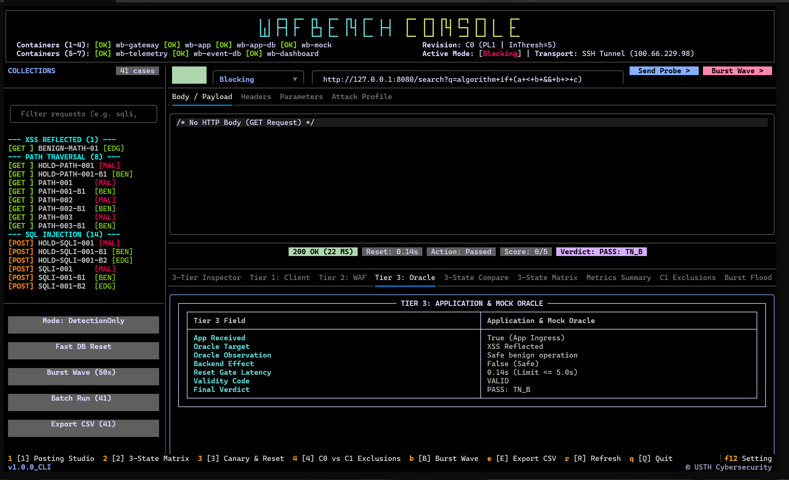

# WAFBench

> **A Lightweight Module for Web Application Firewall (WAF) Testing of OWASP Vulnerabilities**  
> *Auditable, repeatable, and ground-truth empirical evaluation of Nginx, ModSecurity v3, and OWASP Core Rule Set.*

---

## Introduction

A Web Application Firewall (WAF) inspects application-layer HTTP traffic to detect or intercept attacks. However, a rule match, anomaly score, or HTTP 403 alone cannot prove an attack was prevented: the denial may stem from application-level failures, and backend damage may have already occurred. **WAFBench**  is an automated, lightweight evaluation module engineered to provide an accessible, reproducible environment where security practitioners and researchers can empirically measure WAF defensive efficacy under transparent and controlled laboratory conditions.

---

## Key Highlights

- **Three-State Execution Procedure:** Replays each test case across Direct-to-App (`127.0.0.1:8001`), DetectionOnly, and Blocking modes (`:8080`) to isolate WAF decisions from application-side ground truth.
- **Selected Vulnerability Classes & Application Oracles:** Evaluates four representative vulnerability classes (*SQLi on `/login`, Reflected XSS on `/search`, Path Traversal/LFI on `/file`, SSRF on `/fetch`*) with independent application-side oracles.
- **OWASP CRS Baseline & Tuning (C0 → C1):** Pins OWASP CRS v4.0.0 (PL1, inbound threshold 5, body parsers) with formal rule exclusion protocols and holdout regression verification.
- **Cross-Tier Evidence Correlation & Normalized Schema:** End-to-end `X-Request-ID` tracing across Nginx access logs, ModSecurity serial JSON audit logs (`RelevantOnly`), Express, and private mock responder into an ECS-lite PostgreSQL store.
- **Test Runner & Evaluation Dashboard:** Delivers an interactive Textual TUI (`./wafbench --tui`) with 3-tier evidence inspection alongside a Streamlit analytics dashboard (`:8501`) and headless CLI replay.

---

## System Features

* **WAF Gateway & Operating Profile Switching:** Ingress reverse proxy running Nginx 1.26 and ModSecurity v3 with instant switching between `DetectionOnly` and `Blocking (On)`, configurable anomaly thresholds, and zero-downtime reloads.
* **Deterministic Target App & SSRF Mock Enclave:** Node.js 20/Express testbed backed by PostgreSQL 16 and an isolated internal mock responder simulating sensitive metadata (`/metadata`) vs permitted assets (`/public/*`).
* **Interactive Terminal Console & Headless Replay:** Dual-mode CLI delivering a full-screen Posting-inspired Textual terminal interface for exploratory probing, alongside headless flags (`--batch`, `--burst`) for automated test runs.
* **Evaluation Dashboard & Forensics Inspection:** Streamlit dashboard (:8501) visualizing Detection Rate (DR), Blocking Rate (BR), False Positive Rates (detection and blocking FPR), and raw transaction evidence linking client captures to WAF audit trails.
* **Preregistered Corpus & Fixture Reset:** Curated test cases pairing malicious vectors with benign controls (e.g. `O'Reilly`, `O'Brien`), supported by an idempotent reset endpoint (`POST 127.0.0.1:8001/health/reset`) restoring seed state in under 5 seconds.

---

## Evaluation Methodology

* **Three-State Differential Isolation:** Strictly isolates defensive effectiveness from upstream application anomalies by establishing baseline vulnerability via Direct-to-App (`127.0.0.1:8001`) prior to evaluating WAF states (`:8080`).
* **Formal Verdict & Validity Classification:**
  * **Attribute WAF Enforcement:** Requires both an audited WAF disruption (e.g. HTTP 403 with matched rule IDs) AND confirmed absence of backend side-effects to claim mitigation, preventing false attribution.
  * **Validity Rules & Diagnostic Preconditions:** Categorizes failed runs as `Invalid` under documented diagnostic codes (`E_HEALTH`, `E_FIXTURE`, `E_MODE`, `E_CORRELATION`, `E_TELEMETRY`, `E_PIPELINE`) rather than skewing evaluation rates.
  * **Inconclusive Classification Rules:** Separately tracks unstable repetitions (`I_UNSTABLE`), unattributed client denials (`I_UNATTRIBUTED`), and unexplained baseline conflicts (`I_BASELINE_CONFLICT`) without contaminating valid populations.
  * **Disciplined False-Positive Tuning (C0 → C1):** Mandates endpoint- and parameter-scoped rule exclusions validated against paired malicious probes, mandatory regressions, and frozen holdout suites.
  * **Network Segmentation & Trust Boundaries:** Multi-network Docker layout isolates ingress (`frontend-net`), backend dependencies (`backend-net`), and forensic logging (`logging-net`), blocking unauthorized egress.
* **Telemetry Pipeline & Evidence Integrity:**
  * Non-blocking asynchronous log parsing tailing ModSecurity serial JSON audit streams without degrading reverse-proxy throughput.
  * Relational PostgreSQL storage indexing normalized ECS-lite events with JSONB rule match arrays for sub-millisecond forensic queries.
  * Automated fallback mechanisms seamlessly engage bundled historical sample datasets whenever the live PostgreSQL database is offline.
* **Rule Validation & Regression Testing:** Comprehensive test harness validating ANSI sanitization, raw markup escaping, oracle accuracy, rule exclusion regression, and matrix metric derivations.
